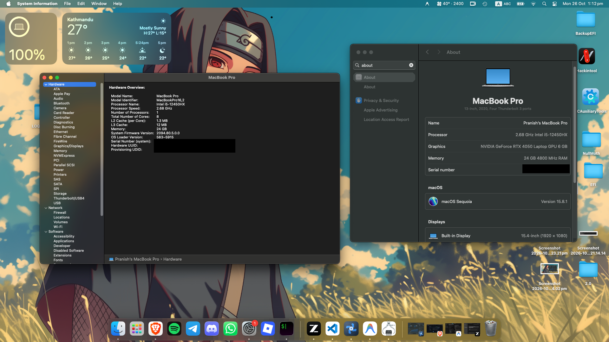
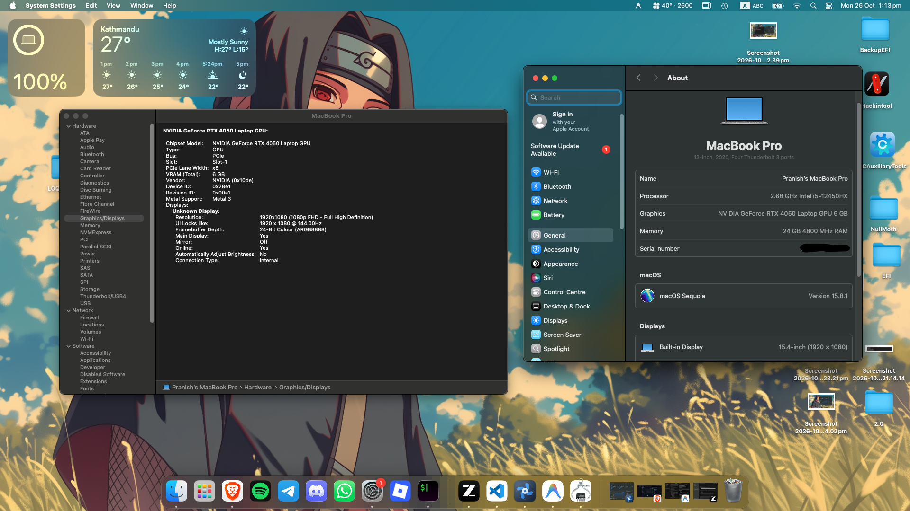

# Lenovo LOQ 15IRX9 / 15IAX9 Hackintosh (macOS Sequoia 15.x)

An OpenCore EFI configuration for the **Lenovo LOQ 15 (12th Gen Intel Alder Lake-HX + NVIDIA GeForce RTX 4050 Mobile)** running macOS Sequoia 15.8.x with **full Metal 3 graphics acceleration** powered by NullMoth NVMTL.

---

## 📸 Screenshots

<p align="center">
  
  
</p>

---

## 💻 Hardware Specifications

| Component | Model / Specification | macOS Status |
| :--- | :--- | :--- |
| **Laptop Model** | Lenovo LOQ 15IRX9 / 15IAX9 (`LENOVO LNVNB161216`) | Fully Supported |
| **Chipset** | Intel HM670 (Alder Lake-HX) | Supported (`DevirtualiseMmio=True`) |
| **Processor** | Intel® Core™ i5-12450HX (4 P-cores + 4 E-cores) | Spoofed to Comet Lake (`0x0A0655`) — **8 Cores & 8 Threads Usable** (HT Disabled) |
| **dGPU** | NVIDIA GeForce RTX 4050 Mobile (AD107M, 6GB GDDR6, `0x28E1`) | **Working with Metal 3 Acceleration** (NullMoth) |
| **iGPU** | Intel® UHD Graphics 16 EU (`8086:4688`) | Disabled via BIOS MUX switch |
| **Display** | 15.6" Full HD (1920x1080) 144Hz IPS | Working (Backlight slider functional) |
| **Audio Codec** | Realtek ALC257 | Working (Layout ID `99` via AppleALC) |
| **Touchpad** | Intel LPSS I2C HID Touchpad (`I2C0@150000`) | Working (Forced Polling Mode + Gestures) |
| **Keyboard** | Standard PS/2 Keyboard with Lenovo Fn keys | Working (`VoodooPS2Keyboard`) |
| **Ethernet** | Realtek RTL8111 Gigabit Ethernet | Working (`RealtekRTL8111.kext`) |
| **Wi-Fi & Bluetooth**| Intel Wi-Fi 6 AX Series | Working (`AirportItlwm` + `IntelBluetoothFirmware`) |
| **Storage** | M.2 NVMe PCIe SSD | Working (`NVMeFix.kext`) |
| **Battery & Thermals**| Lenovo EC Controller (`VPC0`) | Working (`YogaSMC` + `LOQFanMon`) |

---

## ✅ What Works

- [x] **Full Metal 3 Graphics Acceleration** on NVIDIA GeForce RTX 4050 Mobile via NullMoth NVMTL.
- [x] **Internal Display & Brightness Controls**: Native macOS brightness slider and keyboard brightness hotkeys (`nvrmacpibl=1` + `BrightnessKeys.kext`).
- [x] **Audio**: Realtek ALC257 internal stereo speakers, internal microphone, and 3.5mm headphone/mic combo jack.
- [x] **Touchpad**: Multi-touch gestures (pinching, two-finger scroll, three-finger swipe) via `VoodooI2C` in forced-polling mode.
- [x] **Keyboard**: Built-in keyboard and Lenovo function keys.
- [x] **Wireless**: Intel Wi-Fi with native macOS menu bar integration, AirDrop, and Bluetooth audio/peripherals.
- [x] **Battery Management**: Accurate battery percentage, health metrics, and Lenovo conservation mode (limits charge to 80% via `YogaSMC`).
- [x] **Fan Monitoring & Fan Speed Control**: Real-time temperature monitoring and custom fan curve control via [loq-fan-control](https://github.com/pranish-dev/loq-fan-control) and the included custom `LOQFanMon.kext`.
- [x] **True CPU Identity**: Recognized as `12th Gen Intel(R) Core(TM) i5-12450HX` in *About This Mac* (running 8 cores / 8 threads).
- [x] **Display Sleep**: Screen powers down cleanly and wakes instantly upon pressing any key or moving the mouse.

---

## ⚠️ What Doesn't Work (Known Limitations)

- [-] **S3 Deep Sleep (Suspend-to-RAM)**:
  - **Reason**: The RTX 4050 Mobile relies on user-space and AuxKC modules from NullMoth. When the laptop enters S3 deep sleep, PCIe link power to the dGPU is cut. The experimental driver cannot re-initialize the firmware GOP display engine upon resume, resulting in a black screen.
  - **Workaround (Required)**: Configure macOS for **Display Sleep Only** so the system sleeps the display and drops CPU frequency without cutting power to the dGPU:
    ```bash
    sudo pmset -a disablesleep 1 displaysleep 2
    ```

---

## ⚙️ BIOS Settings

Before booting this EFI, boot into the BIOS setup (press <kbd>F2</kbd> or <kbd>Fn+F2</kbd> on startup) and configure the following settings:

### Mandatory Changes
- **Graphics Device**: **Discrete Only / dGPU Only**
  > **CRITICAL**: The laptop's MUX switch must route the internal display directly to the NVIDIA RTX 4050. Leaving this on "Dynamic / Hybrid" mode will route display through the unsupported Intel Alder Lake iGPU, causing boot freezes or black screens.
- **Secure Boot**: **Disabled**
- **Hyper-Threading**: **Disabled**
  > **MANDATORY**: Only **8 cores and 8 threads are usable** (4 P-cores + 4 E-cores). Disabling Hyper-Threading in BIOS is strictly required to prevent macOS XNU thread allocation and scheduler panics on 12th Gen Alder Lake-HX hybrid architecture.
- **Fast Boot**: **Disabled**
- **Intel Virtualization Technology (VT-x)**: **Enabled**
- **Intel VT-d**: **Disabled** (or enabled with `DisableIoMapper = True` in OpenCore)
- **SATA / Storage Controller Mode**: **AHCI / NVMe** (Do not use Intel RST / VMD / RAID mode)
- **USB Boot**: **Enabled**

---

## 🔑 Crucial First-Time Setup (Generate Your Own SMBIOS)

All unique serial numbers have been sanitized for public release. **You MUST generate your own SMBIOS credentials before booting:**

1. Download [CorpNewt's GenSMBIOS](https://github.com/corpnewt/GenSMBIOS).
2. Run `GenSMBIOS.command` and choose option `1` to download MaciASL/data if needed.
3. Select option `3` (Generate SMBIOS) and enter:
   ```text
   MacBookPro16,2
   ```
4. Open `EFI/OC/config.plist` using [ProperTree](https://github.com/corpnewt/ProperTree) or [OCAuxiliaryTools](https://github.com/ic005k/OCAuxiliaryTools).
5. Navigate to `PlatformInfo -> Generic` and replace the following placeholder values:
   - `MLB`: Replace with generated `Board Serial`
   - `SystemSerialNumber`: Replace with generated `Serial`
   - `SystemUUID`: Replace with generated `SmUUID`
   - `ROM`: Set to your physical Ethernet/Wi-Fi MAC address (6 bytes) or leave zeroed.

---

## 🛠️ How It Works (Technical Architecture)

### 1. Graphics Acceleration (NVIDIA RTX 4050 Mobile)
- **Hardware Routing**: In Discrete MUX mode, the laptop panel is physically wired to the NVIDIA RTX 4050 (`10de:28e1`).
- **NullMoth NVMTL (`nullmoth-nvidia` / `1401.app`)**: Uses ported NVIDIA Open Kernel Modules (`NVRM.kext`), a custom framebuffer driver (`NVRMFB.kext`), and a Metal-to-SPIR-V translation layer (`NVAccel.kext`).
- **Framebuffer Exclude**: OpenCore blocks `com.apple.iokit.IONDRVSupport` (`Kernel -> Block -> Exclude`) to prevent Apple's default unaccelerated framebuffer from stealing display index 0.
- **Key Boot Arguments**:
  - `nvfb=1 nvaccel=1 nvfbheads=4`: Forces driver activation and initializes display heads.
  - `-nvkmsnosmooth`: Eliminates micro-stutters in desktop animations.
  - `nvrmacpibl=1`: Bridges the native macOS brightness slider to the Lenovo ACPI backlight registers.
  - `amfi_get_out_of_my_way=0x1 amfi=0x80 ipc_control_port_options=0`: Relaxes sandbox restrictions so NVMTL helper daemons can communicate with the kernel.

### 2. Alder Lake 12th Gen CPU Spoofing (8 Cores & 8 Threads)
- **Core Configuration**: With Hyper-Threading disabled in BIOS, macOS utilizes **8 physical cores and 8 threads** (4 Performance cores + 4 Efficient cores). This eliminates `_cpu_thread_alloc` panics without requiring experimental kernel patches.
- **CPUID Emulation**: Apple never shipped macOS on 12th Gen Alder Lake or hybrid P/E core architectures. OpenCore emulates a 10th Gen Comet Lake Core i9:
  - `Cpuid1Data`: `55 06 0A 00 00 00 00 00 00 00 00 00 00 00 00 00`
  - `Cpuid1Mask`: `FF FF FF FF 00 00 00 00 00 00 00 00 00 00 00 00`
- **Topology Discovery**: `ProvideCurrentCpuInfo = True` forces XNU to query hardware MSRs for the true 8-core topology.
- **TSC Synchronization**: `CpuTscSync.kext` synchronizes the Time Stamp Counter (TSC MSR 0x10) across all 8 cores during early boot to prevent timing desyncs and kernel panics.
- **Cosmetic Branding**: In `NVRAM -> 4D1FDA02-...`, `revpatch = sbvmm,cpuname` and `revcpuname = 12th Gen Intel(R) Core(TM) i5-12450HX` pair with `ProcessorType = 3841` (`0x0F01`) in `PlatformInfo` so "About This Mac" displays the authentic processor name.

### 3. Audio (Realtek ALC257)
- Injected via `AppleALC.kext` under `DeviceProperties`:
  - Device: `PciRoot(0x0)/Pci(0x1f,0x3)`
  - `layout-id`: `99` (0x63, custom layout tailored for Lenovo Legion/LOQ speaker arrays and headphone jack sensing).

### 4. Precision I2C Touchpad
- The touchpad is connected to Intel's LPSS I2C controller (`_SB.PC00.I2C0@150000`).
- Because macOS does not natively handle modern Intel LPSS APIC/GPIO interrupts, standard interrupt mode causes freezes or non-responsive touch.
- **Solution**: Forced into **polling mode** via:
  - Boot argument: `-vi2c-force-polling`
  - DeviceProperty for `PciRoot(0x0)/Pci(0x15,0x0)`: `force-polling: 1`
  - Kexts: `VoodooI2C.kext` + `VoodooI2CHID.kext` (providing smooth multi-touch gestures).

### 5. Keyboard & Interrupter Safety
- Built-in keyboard runs through `VoodooPS2Controller.kext` (`VoodooPS2Keyboard.kext`).
- `CpuTopologyRebuild.kext` is **deliberately removed/disabled** because its core reallocation routine alters APIC interrupt vectors, which breaks the PS/2 keyboard controller on Lenovo laptops.

### 6. Power Management, Thermals & Fan Control
- `SSDT-GPRW.aml` + ACPI binary rename `GPRW -> XPRW` neutralizes USB-C / XDCI instant wakeups (`GPRW(0x6D, 0x04)`).
- `YogaSMC.kext` interfaces with the Lenovo Embedded Controller (`LPCB.EC0`) for battery charge thresholds and system mode management.
- Custom `LOQFanMon.kext` exposes the LOQ's dual fans (`GZFD` ACPI device) to macOS. Pair it with **[loq-fan-control](https://github.com/pranish-dev/loq-fan-control)** to monitor CPU/GPU thermal sensors and control fan curves directly within macOS.

---

## 📁 Repository Structure

```text
EFI/
├── BOOT/
│   └── BOOTx64.efi
└── OC/
    ├── ACPI/
    │   ├── DSDT.aml          (Custom LOQ ACPI table)
    │   ├── SSDT-EC.aml        (Embedded Controller dummy)
    │   ├── SSDT-GPRW.aml      (Sleep instant-wake patch)
    │   ├── SSDT-PLUG-ALT.aml  (Alder Lake CPU power management)
    │   ├── SSDT-RTCAWAC.aml   (RTC/AWAC fix)
    │   └── SSDT-XOSI.aml      (Windows 10/11 ACPI feature emulation)
    ├── Drivers/
    │   ├── HfsPlus.efi
    │   ├── OpenCanopy.efi
    │   ├── OpenRuntime.efi
    │   └── ResetNvramEntry.efi
    ├── Kexts/
    │   ├── AMFIPass.kext
    │   ├── AirportItlwm.kext
    │   ├── AppleALC.kext
    │   ├── BlueToolFixup.kext
    │   ├── BrightnessKeys.kext
    │   ├── CpuTscSync.kext
    │   ├── IntelBTPatcher.kext
    │   ├── IntelBluetoothFirmware.kext
    │   ├── LOQFanMon.kext
    │   ├── Lilu.kext
    │   ├── NVMeFix.kext
    │   ├── RealtekRTL8111.kext
    │   ├── RestrictEvents.kext
    │   ├── SMCBatteryManager.kext
    │   ├── SMCLightSensor.kext
    │   ├── SMCProcessor.kext
    │   ├── VirtualSMC.kext
    │   ├── VoodooI2C.kext
    │   ├── VoodooI2CHID.kext
    │   ├── VoodooPS2Controller.kext
    │   ├── WhateverGreen.kext
    │   └── YogaSMC.kext
    ├── Resources/            (OpenCanopy GUI icons and fonts)
    ├── Tools/
    │   └── NullMothSafe.efi  (NullMoth safe boot & driver uninstaller)
    └── config.plist
```

---

## ⚡ Post-Install Recommendations

1. **Disable System Sleep to Prevent Black Screens**:
   ```bash
   sudo pmset -a disablesleep 1 displaysleep 2
   ```
2. **Install NullMoth NVMTL**:
   Ensure `1401.app` (NullMoth companion app) is installed in `/Applications` to manage driver updates and Metal 3 translation caches.
3. **Monitor Temps & Control Fans**:
   Install and run **[loq-fan-control](https://github.com/pranish-dev/loq-fan-control)** to monitor real-time CPU/GPU temperatures and set custom fan speeds using the injected `LOQFanMon.kext`.

---

## 🤝 Credits

- [Acidanthera](https://github.com/acidanthera) for OpenCorePkg, Lilu, VirtualSMC, AppleALC, VoodooPS2, and RestrictEvents.
- [NullMoth](https://github.com/nullmoth/nvidia-macos-driver) for the groundbreaking NVMTL macOS driver stack for NVIDIA Ada Lovelace.
- [OpenIntelWireless](https://github.com/OpenIntelWireless) for AirportItlwm and IntelBluetoothFirmware.
- [VoodooI2C](https://github.com/VoodooI2C/VoodooI2C) for precision I2C touchpad support.
- [YogaSMC](https://github.com/zhen-zen/YogaSMC) for Lenovo platform controller support.
- Dortania for the OpenCore Install Guide.
